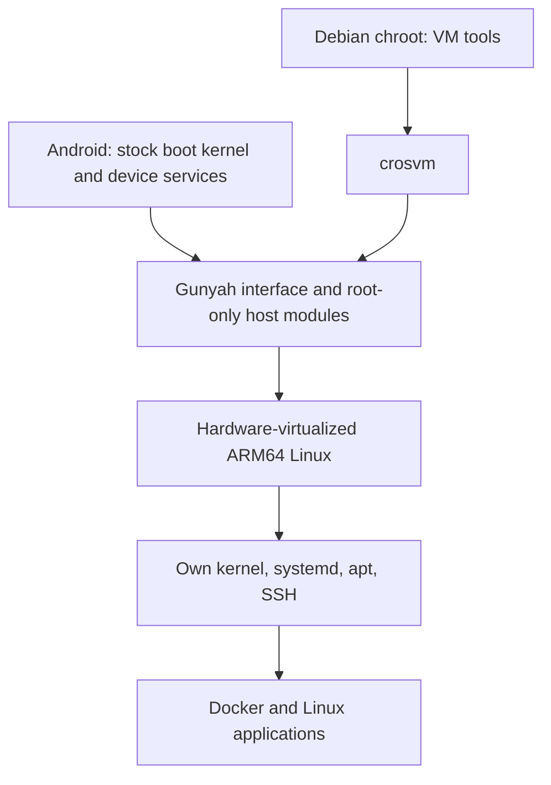

# Android Linux Hardware VM

**A full Linux operating system and Docker on Android, using hardware virtualization without replacing the stock Android boot kernel.**

[Русская версия](README.ru.md) · [Quick start](docs/QUICKSTART.md) · [Five approaches](docs/APPROACHES.md) · [Requirements](docs/REQUIREMENTS.md)

Use Linux as your main **development, server and command-line environment** on a supported phone. The guest has its own ARM64 kernel, systemd, package manager, persistent disks and Docker daemon. Android continues to run alongside it and owns the physical hardware.

This is hardware virtualization through **Gunyah**, exposed by a supported Qualcomm/Android platform. It is not CPU emulation, a PRoot environment, or a Docker daemon forced to run against Android's kernel.

## Why this exists

Root access does not supply kernel features that were omitted or restricted by an Android vendor. A chroot changes the filesystem view; it still uses the Android kernel. Containers also depend on their host kernel.

A hardware VM gives Linux a different kernel. Namespaces, cgroups, overlayfs, netfilter and the other facilities needed by Docker can be built into **the guest kernel**, while the phone keeps its vendor boot kernel. The same boundary makes the guest useful as a general Linux system, beyond Docker.

**Stock kernel does not mean unrooted or unmodified execution:** this port requires root and privileged, ABI-matched modules loaded into the running Android kernel. It does not flash a replacement Android kernel or promise support on every Snapdragon device.



## Reference port

- ASUS ROG Phone 8 / AI2401, Android 16, 12 GB physical RAM.
- Android kernel `6.1.112-android14-11-g76e6db6a5f77-ab13748698` and its recorded BTF fingerprint.
- Real root, a Debian ARM64 **chroot**, `/dev/gunyah`, and a Gunyah-capable Android crosvm.
- A custom **guest** Linux 6.18.16 for the custom-kernel profiles.
- Dynamic guest assignment from **256 MiB to 4096 MiB**, in 128 MiB increments. This is the implemented and exercised policy ceiling, not a discovered hardware maximum.

Other devices need a port: matching firmware interfaces, kernel ABI, modules, compiler and device-tree layout. A Snapdragon SoC alone is insufficient. [Requirements and support boundaries](docs/REQUIREMENTS.md).

## Choose an approach

| Profile | Guest RAM | Extra components | Complexity | Main trade-off |
|---|---:|---|---|---|
| `classic` | 1024 MiB fixed | Reserve module, pre-start guard | Lowest in this project | Small capacity; one large main parcel |
| `split` | 1664 MiB fixed by default | Legacy label adapter, two main parcels | Medium | More capacity, tighter coupling to legacy RM layout |
| `shared` | 4096 MiB fixed | Fresh-page layout helper, bounded shared parcels | High | Reserves all RAM before boot; more backing/metadata overhead |
| `custom-fixed` | 3072 MiB fixed | Custom guest kernel and layout helper | High | Full control of guest features; guest-kernel maintenance |
| `grow` | 256 → 4096 MiB | Custom guest kernel, runtime-share helper, guest accept/hot-add module, agent | Highest implementation complexity | Lowest idle reservation; no live memory return |

The recommended direction is **`grow`** when workloads vary and Android needs the remaining RAM. The fixed profiles remain useful for simpler diagnosis, predictable reservations and understanding the implementation stages. [Detailed comparison](docs/APPROACHES.md).

## Getting started

This is a **source release for a specific reference port**, not a universal APK or a one-click KernelSU module. No personal disk images, keys or precompiled kernel modules are included.

1. Establish real root and a proper Debian chroot on the supported Android host.
2. Build the ABI-matched host modules, userspace shims and guest kernel: [build instructions](docs/BUILD.md).
3. Configure a private local state directory and create a **fresh** Debian guest:

```sh
./droidvm configure \
  --android-rootfs /data/data/com.termux/files/usr/var/lib/proot-distro/containers/debian/rootfs
sudo python3 scripts/create-rootfs.py
sudo python3 scripts/make-initrd.py
./droidvm doctor --profile grow
```

4. Start Linux, use Docker, and stop the guest normally:

```sh
sudo ./droidvm up grow
sudo ./droidvm ssh
# Inside the Linux guest:
#   uname -a
#   docker info
#   docker run --rm hello-world

# Or send a command from the chroot:
sudo ./droidvm exec 'uname -a; docker info'
sudo ./droidvm down
```

`DROIDVM_STATE` selects the local state directory; default: `/var/lib/android-linux-hardware-vm`. Keep that setting consistent for configure, image creation and all lifecycle commands. See [Quick start](docs/QUICKSTART.md) for exact dependencies and the preparation order.

## What you get, and what you do not

**Available:** a persistent ARM64 Linux system, its own kernel features, Docker inside Linux, SSH, an independent guest network namespace, virtio storage, a workspace disk and memory growth without restarting the guest.

**Not provided:** bare-metal Linux boot in place of Android; GPU/display/touch/camera/modem passthrough; a finished accelerated desktop; nested virtualization; live memory reclamation; VM migration; or a security boundary for untrusted guests. A remote desktop inside the guest is a separate integration task.

The reference path uses root and `--disable-sandbox` for crosvm. Trust both the guest and its disk images. The protected-VM command-line flag is not a promise of confidential computing or host/guest security isolation. [Limitations and security](docs/LIMITATIONS.md).

## RAM and lifecycle

- Reserve physically suitable backing **before** lending/sharing it with RM.
- Reject missing pages and parcels above **512 scatter/gather entries**; do not rely on an unbounded append path.
- Keep Android headroom: `max(2048 MiB, 20% of MemTotal) + 512 MiB`, plus the next allocation.
- For `grow`, add 128 MiB when guest `MemAvailable` drops below 256 MiB; cap assignment at 4096 MiB.
- Preserve pins and mappings until normal guest shutdown. Stop acquisition, wait for all counters to drain, then unload owned modules and check offline disks.
- Do not force-unload modules, force-kill a blocked VMM, reset RM, or automatically reboot the phone.

The guest can use virtual RAM only after RM acceptance **and** Linux memory onlining. This implementation has no live shrink: shut down the guest to return its reservation. The VMM's boot-time memory map is not extended; the protected virtio path uses the initial restricted DMA pool. [Architecture](docs/ARCHITECTURE.md).

[Fresh-image reference bring-up record](docs/REFERENCE.md).

## Project layout

- `droidvm`, `lib/droidvm/`: CLI, lifecycle, ABI gates, networking and telemetry.
- `profiles/`: five memory strategies.
- `modules/`: reserve pool, label adapter, private backing layout and grow-only host/guest helpers.
- `shims/`: legacy ioctl/FDT compatibility and guarded memory registration.
- `guest/`, `scripts/`: fresh rootfs, guest kernel and initramfs builders.
- `devices/`: explicit reference device/ABI metadata, not an unrestricted compatibility claim.

## Credits and license

GPL-2.0-only for this integration and its kernel helpers, retaining upstream notices. The reserve pool is derived from **[Droid-VM/gh-hugepage-reserve](https://github.com/Droid-VM/gh-hugepage-reserve)**; guest RM transport is derived from **[Droid-VM/droidvm-guest-additions](https://github.com/Droid-VM/droidvm-guest-additions)**. Gunyah kernel structures come from the Android common kernel; libfdt retains its upstream dual license. This project does not claim authorship of those upstream components.

See [THIRD_PARTY.md](THIRD_PARTY.md) for pinned sources, licenses and modifications; [crosvm documentation](https://crosvm.dev/book/) and [Linux memory-hotplug documentation](https://docs.kernel.org/admin-guide/mm/memory-hotplug.html) for the underlying facilities.
